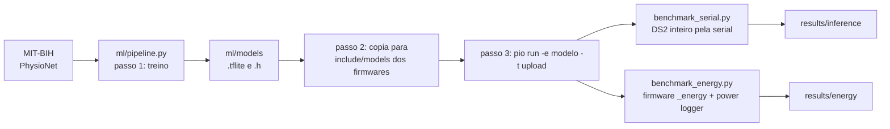

# Benchmarking de modelos TinyML para detecção de arritmias cardíacas

Comparação de **seis classificadores de batimentos de ECG** rodando em **dois
microcontroladores**: um ESP32-S3 (Xtensa LX7) e uma STM32 NUCLEO-F767ZI
(Arm Cortex-M7). Os modelos são treinados no MIT-BIH Arrhythmia Database,
convertidos para C/C++ e medidos na placa em três frentes:

| Frente | O que se mede | Onde |
|---|---|---|
| **Desempenho de classificação** | acurácia, sensibilidade, especificidade, F1 e F-beta no conjunto de teste (DS2), com o modelo rodando **na placa** | `<mcu>_firmware/scripts/benchmark_serial.py` |
| **Tempo e memória** | tempo de inferência e do filtro, vazão, tamanho do modelo (flash) e RAM | `<mcu>_firmware/scripts/benchmark_serial.py` |
| **Corrente e energia** | energia por inferência (Einf), corrente e potência durante a inferência e em repouso | `power_logger/scripts/benchmark_energy.py` |

## Sumário

- [Modelos e placas](#modelos-e-placas)
- [Estrutura do repositório](#estrutura-do-repositório)
- [Visão geral do fluxo](#visão-geral-do-fluxo)
- [Pré-requisitos](#pré-requisitos)
- [Passo a passo](#passo-a-passo)
- [Metodologia](#metodologia)
- [Resultados gerados](#resultados-gerados)
- [Referências](#referências)

## Modelos e placas

| Código | Modelo | Entrada | Formato na placa |
|---|---|---|---|
| `cnn_rn` | CNN ResNet-1D | janela de 256 amostras + 4 features de RR | `.tflite` int8 (TFLite Micro) |
| `cnn_mn2` | CNN MobileNetV2-1D | idem | `.tflite` int8 (TFLite Micro) |
| `cnn_mn3` | CNN MobileNetV3-1D | idem | `.tflite` int8 (TFLite Micro) |
| `mlp` | MLP (256-64-16) | 12 features morfológicas + 4 de RR | `.tflite` int8 (TFLite Micro) |
| `rf` | Random Forest | 12 features morfológicas + 4 de RR | código `if/else` gerado pelo emlearn |
| `svm` | SVM (kernel RBF) | 12 features morfológicas + 4 de RR | arrays C (vetores de suporte em int16) |

| Placa | Núcleo | Clock | Flash | Framework | Detalhes |
|---|---|---|---|---|---|
| ESP32-S3 DevKitC-1 | Xtensa LX7 dual-core | 240 MHz | 8 MB | ESP-IDF 5.4.1 + esp-tflite-micro + ESP-NN | [`esp32_firmware/README.md`](esp32_firmware/README.md) |
| STM32 NUCLEO-F767ZI | Arm Cortex-M7 + FPU de precisão dupla | 216 MHz | 2 MB | STM32Cube HAL + TFLite Micro + CMSIS-NN | [`stm32_firmware/README.md`](stm32_firmware/README.md) |

O medidor de energia (um terceiro ESP32 com um INA226) está em
[`power_logger/README.md`](power_logger/README.md).

## Estrutura do repositório

```
tinyml-benchmarking/
├── ml/                         treinamento e exportação dos modelos (Python)
│   ├── pipeline.py             roda as etapas: treinar, copiar para os firmwares, gravar
│   ├── src/
│   │   ├── load_data.py        download do MIT-BIH, divisão DS1/DS2, filtro, features de RR
│   │   ├── helpers.py          features morfológicas, quantização int8, busca de hiperparâmetros
│   │   ├── metrics.py          métricas AAMI (usadas no treino e no benchmark da placa)
│   │   ├── energy_beats.py     batimentos do DS2 gravados no firmware de energia
│   │   ├── model_size.py       tamanho real do Random Forest, medido no binário
│   │   └── classifiers/        um script de treino por modelo
│   └── models/                 modelos exportados (.tflite e .h)
├── esp32_firmware/             firmware do ESP32-S3 (PlatformIO + ESP-IDF)
├── stm32_firmware/             firmware da NUCLEO-F767ZI (PlatformIO + STM32Cube)
└── power_logger/               firmware e script do medidor de corrente/energia
```

## Visão geral do fluxo



## Pré-requisitos

- **Python 3** com: `tensorflow`, `scikit-learn`, `numpy`, `scipy`, `pandas`,
  `matplotlib`, `joblib`, `wfdb`, `neurokit2`, `emlearn`, `pyelftools` e
  `pyserial`. O `ml/requirements.txt` lista os pacotes de versão fixa ou menos
  comuns.
- **PlatformIO** (CLI `pio` ou a extensão do VS Code). Ele baixa sozinho as
  toolchains e frameworks das placas na primeira compilação.
- **Hardware:** ESP32-S3 DevKitC-1, NUCLEO-F767ZI, e para o teste de energia
  um ESP32 extra (DevKit) com um módulo INA226.

## Passo a passo

### 1. Treinar os modelos e copiar para os firmwares

Em `ml/pipeline.py`, deixe descomentadas as etapas que quer rodar (a função
`main()` no fim do arquivo) e execute:

```bash
python ml/pipeline.py
```

| Etapa | Função | O que faz |
|---|---|---|
| 1 | `run_trainings([...])` | treina os modelos escolhidos (`cnn_rn`, `cnn_mn2`, `cnn_mn3`, `mlp`, `rf`, `svm`) e salva em `ml/models/` |
| 2 | `copy_model_files(...)` | converte cada `.tflite` em um array C (`<modelo>.h`) e copia os `.h` para `include/models/` dos dois firmwares |
| 2b | `write_energy_test_beats(...)` | gera `include/data/energy_beats.h` (32 batimentos do DS2) para o firmware de energia |
| 3 | `build_and_upload_firmware(...)` | compila e grava um modelo na placa (também dá para fazer pelo `pio`) |

Na primeira execução o MIT-BIH é baixado para `ml/data/mitdb/` e o dataset
processado fica em cache em `ml/data/cache/`.

### 2. Gravar um modelo na placa

Só cabe um modelo por vez. Cada modelo é um *environment* do PlatformIO:

```bash
cd esp32_firmware            # ou stm32_firmware
pio run -e cnn_rn -t upload  # cnn_rn, cnn_mn2, cnn_mn3, mlp, rf ou svm
```

### 3. Teste de classificação e tempo (DS2)

```bash
python esp32_firmware/scripts/benchmark_serial.py COM3 cnn_rn
python stm32_firmware/scripts/benchmark_serial.py COM5 cnn_rn
```

O script envia **todos os batimentos do DS2** pela serial, um por vez, e a
placa responde com a classe prevista e os tempos medidos nela. Leva horas;
se parar, rode de novo com `--resume`. Detalhes em cada README de firmware.

### 4. Teste de corrente e energia

Grave o firmware de energia (`pio run -e cnn_rn_energy -t upload`), monte o
circuito com o INA226 e rode:

```bash
python power_logger/scripts/benchmark_energy.py COM6 esp32 cnn_rn --profile
```

O passo a passo completo, com as ligações, está em
[`power_logger/README.md`](power_logger/README.md).

## Metodologia

### Dataset e divisão inter-paciente

- **Base:** [MIT-BIH Arrhythmia Database](https://physionet.org/content/mitdb/1.0.0/),
  derivação MLII, 360 Hz.
- **Classes AAMI (EC57):** N, S, V, F e Q.
- **Divisão de de Chazal et al. (2004):** cada paciente fica inteiro em um
  conjunto, para que o modelo não "reconheça o paciente" no teste.
  - **DS1** (treino), com os registros 118, 124, 205 e 223 separados para
    validação (*early stopping* e escolha de hiperparâmetros);
  - **DS2** (teste), usado só nas métricas finais e no benchmark nas placas.
- **Registros com marcapasso** (102, 104, 107, 217) ficam de fora, como no
  protocolo AAMI. Por isso as médias macro são calculadas sobre N, S, V e F,
  e também sobre N, S e V (quase todo o F do DS2 vem de um único registro).

### Pré-processamento (igual no treino e na placa)

- **Janela:** 256 amostras centradas no pico R.
- **Filtro:** passa-banda Butterworth de 4ª ordem, 0,5–45 Hz, em seções de
  segunda ordem (SOS), aplicado **na placa** a cada janela isolada. O nível da
  primeira amostra é subtraído antes de filtrar. O computador envia o ECG cru.
- **Features de RR:** 4 razões logarítmicas entre intervalos RR (prematuridade,
  pausa depois do batimento, pausa compensatória e prematuridade em relação ao
  ritmo de base), calculadas no computador e enviadas junto com cada batimento.
- **MLP, RF e SVM:** usam 12 features morfológicas, extraídas **na placa**,
  mais as 4 de RR. As CNNs recebem a janela filtrada e as 4 de RR.

### Treinamento

- **CNNs e MLP:** treinadas em Keras, com a época escolhida pelo macro-F1 na
  validação e quantização **int8 completa** (pesos, ativações, entrada e
  saída) na conversão para `.tflite`.
- **SVM e Random Forest:** busca de hiperparâmetros na validação. Entre as
  configurações a até 0,01 do melhor macro-F1, fica a **menor** (menos flash e,
  na SVM, menos RAM e tempo). Configurações acima de 200 KB são descartadas.

### Tempo de inferência

- **Contador de ciclos da CPU:** `CCOUNT` no ESP32-S3 e `DWT->CYCCNT` na
  STM32, convertido para µs.
- **Duas medidas separadas:**
  - **filtro SOS** (`filter_us`);
  - **inferência** (`inference_us`): a chamada `classify()`, que inclui a
    extração de features no MLP, no RF e na SVM.
- **Fora da medida:** a transferência pela serial.

### Tamanho dos modelos

Para contabilizar o tamanho dos modelos, foi considerado o arquivo `.tflite`
gerado para as redes CNN e MLP. Na SVM, o tamanho foi calculado pela soma dos
arrays convertidos para C (vetores de suporte e coeficientes duais, em int16,
mais interceptos e índices: `SVM_MODEL_BYTES` em `svm_classifier.h`). No
*Random Forest*, cuja conversão gera estruturas de decisão em comandos
`if/else`, foi medido o espaço ocupado pelo bloco correspondente no binário do
*firmware*, conforme os dados reportados pelo *linker*
(`<mcu>_firmware/scripts/model_size.py`, a partir de `.pio/build/rf`).

A RAM reportada é a *arena* do TFLite Micro efetivamente usada (CNN e MLP) e o
buffer de valores do kernel (SVM). O Random Forest não usa RAM além da pilha.

### Compilação

Os arquivos `.tflite` dos modelos neurais foram convertidos em arrays C/C++ e
incorporados a cabeçalhos do projeto (`include/models/<modelo>.h`, alinhados a
16 bytes e `const`, então ficam na flash), em vez de serem fornecidos ao
*linker* como arquivos binários externos.

A compilação utilizou o **GCC 14.2.0 no ESP32-S3** e o **GCC 12.3.1 no STM32**.
Para este último, a versão inicialmente disponível era a 8.2.1. Adotou-se a
versão 12.3.1 para aproximar as versões das *toolchains*; não havia um pacote
do GCC 14 para o STM32 no servidor do PlatformIO.

| | ESP32-S3 | STM32 NUCLEO-F767ZI |
|---|---|---|
| Compilador | GCC 14.2.0 (Xtensa) | GCC 12.3.1 (`toolchain-gccarmnoneeabi ~1.120301.0`) |
| Otimização | `-O2` (`CONFIG_COMPILER_OPTIMIZATION_PERF`) | `-O2` |
| Kernels otimizados | ESP-NN | CMSIS-NN |
| Ponto flutuante | FPU de precisão simples | FPU de precisão dupla (`-mfpu=fpv5-d16 -mfloat-abi=hard`) |

### Energia

- **Medidor:** um ESP32 extra lê um INA226 em série com a alimentação do chip
  sob teste.
- **Ciclo do firmware de energia:** a placa alterna repouso (5 s) e uma rajada
  de inferências seguidas (3 s), e inverte um pino de sincronismo antes de
  cada inferência.
- **Cálculo:** a energia por inferência acima do repouso é obtida por
  subtração de linha de base: `Einf = (E_burst − P_idle × T) / N`.

Explicação completa em [`power_logger/README.md`](power_logger/README.md).

## Resultados gerados

Os resultados ficam em cada firmware (e não vão para o git):

```
<mcu>_firmware/results/
├── inference/
│   ├── <modelo>_serial.csv          uma linha por batimento (classe real, prevista, tempos)
│   ├── <modelo>_report.txt          métricas AAMI + tempo, memória e vazão
│   └── <modelo>_info.json           tamanho e RAM do modelo reportados pela placa
└── energy/
    ├── <modelo>_energy.csv          uma linha por burst
    ├── <modelo>_energy_report.txt   média ± desvio padrão [mín .. máx] sobre os bursts
    └── <modelo>_current_profile.csv perfil de corrente (com --profile)
```

Os relatórios podem ser refeitos a partir dos CSVs, sem a placa:
`benchmark_serial.py ... --resume` e `benchmark_energy.py <mcu> <modelo> --report-only`.

## Referências

- Dataset: [MIT-BIH Arrhythmia Database](https://physionet.org/content/mitdb/1.0.0/) (PhysioNet)
- Divisão inter-paciente: de Chazal, O'Dwyer e Reilly, *Automatic classification
  of heartbeats using ECG morphology and heartbeat interval features*, IEEE TBME, 2004
- Tutoriais:
  - [SVM classifier tutorial](https://www.kaggle.com/code/prashant111/svm-classifier-tutorial)
  - [Random Forest classifier tutorial](https://www.kaggle.com/code/prashant111/random-forest-classifier-tutorial)
  - [TensorFlow: CNN](https://www.tensorflow.org/tutorials/images/cnn?hl=pt-br)
  - [TensorFlow: MLP](https://www.tensorflow.org/guide/core/mlp_core)
- Implementações de referência:
  - CNN: [physhik/ecg-mit-bih](https://github.com/physhik/ecg-mit-bih)
  - MLP: [carrliitos/ecg_classification](https://github.com/carrliitos/ecg_classification)
  - Random Forest: [crs4/rf-ecg-heartbeat-classification](https://github.com/crs4/rf-ecg-heartbeat-classification)
  - SVM: [mondejar/ecg-classification](https://github.com/mondejar/ecg-classification)
