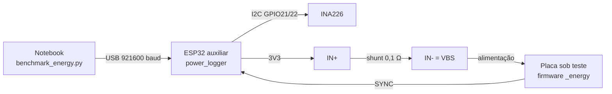

# Power logger: teste de corrente e energia

Medidor de corrente e energia dos modelos. Um **ESP32 auxiliar** lê um sensor
**INA226** ligado em série com a alimentação do chip sob teste (DUT) e mede
cada rajada de inferências. O script `scripts/benchmark_energy.py` controla o
logger pela serial e gera os resultados.

É o modo extra, ao lado do teste do DS2 (`<mcu>_firmware/scripts/benchmark_serial.py`).
Para cada placa (ESP32-S3 e STM32 NUCLEO-F767ZI) e para cada modelo
(`cnn_rn`, `cnn_mn2`, `cnn_mn3`, `mlp`, `rf`, `svm`), separadamente, mede:

| Medida | O que é |
|---|---|
| **Einf** | energia por inferência acima do repouso: `Einf = (E_burst − P_idle × T) / N` |
| **Energia durante a inferência** | energia de uma inferência com o repouso incluído: `Einf + P_idle × t_inf` (= `P_inf × t_inf`) |
| **Corrente e potência durante a inferência** | `I_inf` e `P_inf`, médias enquanto o MCU infere, e `dI_inf` e `dP_inf`, o quanto ficam acima do repouso |
| **Repouso** | corrente, tensão e potência do MCU parado, medidas logo antes de cada rajada |
| **Perfil de corrente** (`--profile`) | corrente no tempo, um ponto a cada ~0,34 ms (uma conversão do INA226) |
| **t_inf** | tempo de inferência medido pelo pino de sincronismo |

Visão geral do projeto: [README principal](../README.md).

## Sumário

- [Como funciona](#como-funciona)
- [Hardware](#hardware)
- [Conexões](#conexões)
- [Passo a passo](#passo-a-passo)
- [Resultados](#resultados)
- [Protocolo serial do logger](#protocolo-serial-do-logger)
- [Problemas comuns](#problemas-comuns)

## Como funciona



Durante a medição o chip da placa sob teste é alimentado **só pelo INA226** e
não tem ligação serial com o computador. Por isso ele não recebe batimentos
pela serial: roda o firmware de energia (`<modelo>_energy`), que tem 32
batimentos do DS2 gravados nele (8 de cada classe N, S, V, F) e repete para
sempre:

```
repouso 5 s  ->  rajada: inferências seguidas por 3 s  ->  repouso 5 s  -> ...
```

- **Repouso** é o MCU parado com os clocks ligados. No ESP32-S3, é a tarefa
  bloqueada em `vTaskDelay` (os núcleos ficam em `waiti`). Na STM32, é um
  laço de `WFI` (modo *Sleep*, acordado pelo SysTick).
- **Pino de sincronismo:** antes de cada inferência, a placa inverte o pino.
  O ESP32 auxiliar conta as bordas em hardware (PCNT), então sabe exatamente
  quantas inferências (N) rodaram e onde começa e termina cada rajada.
  Inverter o pino, em vez de mandar um pulso, não exige largura mínima de
  pulso e acrescenta só uma escrita de registrador ao laço de inferência.
- **Medição de cada rajada:** o logger integra a potência na janela da rajada
  e subtrai o repouso medido logo antes dela. Isso cancela deriva lenta
  (temperatura, fonte), o offset do INA226 e o consumo fixo da placa (LEDs,
  reguladores).
- **Tempo de inferência:** `t_inf = (última borda − primeira borda) / (N − 1)`.

É a mesma técnica do *EnergyRunner* do MLPerf Tiny, que usa um GPIO de
*timestamp*.

### Cálculos

```
E_total = ∫ P dt                       (na janela da rajada, de duração T)
E_net   = E_total − P_idle × T         (energia acima do repouso)
Einf    = E_net / N                    (energia por inferência)
dI_inf  = Q_net / (N × t_inf)          (corrente média acima do repouso)
I_inf   = I_idle + dI_inf
```

O tempo de repouso dentro da janela soma ~0 ao `E_net`, então a janela só
precisa conter as inferências, não estar alinhada a elas.

## Hardware

| Componente | Função |
|---|---|
| ESP32 auxiliar (ESP32 DevKit, `board = esp32dev`) | lê o INA226, conta as bordas de sincronismo e calcula as medidas; ligado ao notebook por USB |
| Módulo INA226 | mede a queda no resistor *shunt* (corrente) e a tensão de barramento; I²C a 400 kHz, endereço 0x40 |
| Resistor *shunt* do módulo | 0,1 Ω (marcação `R100`) por padrão; informe outro valor com `--rshunt` |
| Placa sob teste | ESP32-S3 DevKitC-1 ou NUCLEO-F767ZI com o firmware `<modelo>_energy` |

O INA226 faz uma conversão a cada ~0,34 ms com a configuração padrão
(`CFG 1 140 204`: sem média, 140 µs na tensão e 204 µs na corrente).

## Conexões

O **GND precisa ser comum** entre o ESP32 auxiliar, o INA226 e a placa sob
teste, porque o sinal de sincronismo é referenciado a ele.

### Comum às duas placas

Conexões do INA226 e do ESP32 auxiliar para aquisição das medições:

| Sinal/componente | Origem (pino) | Destino (pino) | Observações |
|---|---|---|---|
| Alimentação do ESP32 auxiliar | Notebook (porta USB) | ESP32 auxiliar (USB) | Alimenta o ESP32 auxiliar, que opera fora do domínio medido |
| Alimentação do INA226 (VCC) | ESP32 auxiliar 3V3 | INA226 VCC | Alimentação do sensor a partir do auxiliar, fora do laço medido |
| Terra comum (GND) | ESP32 auxiliar GND | INA226 GND | Nó de terra único, compartilhado com a placa sob teste |
| I²C (dados) | ESP32 auxiliar GPIO21 | INA226 SDA | Endereço I²C fixo de fábrica (típico 0x40), confirmado por *scanner* |
| I²C (*clock*) | ESP32 auxiliar GPIO22 | INA226 SCL | Mesmo barramento do SDA |
| Entrada positiva do *shunt* (IN+) | ESP32 auxiliar 3V3 | INA226 IN+ | Lado da fonte: o 3V3 do auxiliar alimenta a placa sob teste através do *shunt* |
| Referência da tensão de barramento (VBS) | INA226 VBS | INA226 IN- | Tensão de barramento referenciada ao lado da carga; verificar se a ponte já existe no módulo |
| Alerta (ALE) | INA226 ALE | Não conectado | Função de alerta não utilizada |
| Sincronismo | pino da placa sob teste (abaixo) | ESP32 auxiliar GPIO4 | Sem *pull-up* nem *pull-down*: a placa sob teste controla o nível |

### ESP32-S3

Conexões da placa ESP32-S3 utilizada na inferência:

| Sinal/componente | Origem (pino) | Destino (pino) | Observações |
|---|---|---|---|
| Alimentação da placa (saída do *shunt*) | INA226 IN- | ESP32-S3 3V3 | Único caminho de energia do chip; cabo USB do ESP32-S3 desconectado durante a medição |
| Terra comum (GND) | ESP32-S3 GND | GND comum | Nó único com o ESP32 auxiliar e o INA226 |
| Sincronismo | ESP32-S3 GPIO4 (saída) | ESP32 auxiliar GPIO4 (entrada) | Invertido antes de cada inferência; o logger conta as bordas para marcar início e fim de cada rajada |

### STM32 NUCLEO-F767ZI

Conexões da placa STM32 NUCLEO-F767ZI utilizada na inferência:

| Sinal/componente | Origem (pino) | Destino (pino) | Observações |
|---|---|---|---|
| Alimentação do STM32 (saída do *shunt*) | INA226 IN- | NUCLEO JP5 (IDD), pad do lado do STM32 | Jumper IDD removido; pad do lado do regulador sem conexão; ST-LINK permanece conectado por USB, fora do domínio medido pelo INA226 |
| Terra comum (GND) | NUCLEO GND | GND comum | Nó único com o ESP32 auxiliar e o INA226 (qualquer GND, não o AGND) |
| Sincronismo | NUCLEO PF13 (D7) (saída) | ESP32 auxiliar GPIO4 (entrada) | Invertido antes de cada inferência; o logger conta as bordas para marcar início e fim de cada rajada |

Na STM32 o **USB do ST-LINK fica conectado durante a medição** (são dois
cabos USB: o do ESP32 auxiliar e o da Nucleo):

- **Não há conflito de fontes.** Com o jumper JP5 retirado, o regulador da
  Nucleo alimenta só o ST-LINK e o resto da placa. O chip STM32 é alimentado
  só pelo INA226, pelo pad "STM32" do JP5. É o uso previsto do JP5 no manual
  da placa (UM1974, seção 7.7: tirar o jumper e ligar um medidor no lugar).
- **Sem o USB, a STM32 fica reiniciando** (o LED COM pisca e não sai nenhuma
  rajada). O ST-LINK, sem alimentação, interfere no reset (NRST) do chip. O
  manual (seção 7.4.2) exige cortar a placa ou retirar o SB111 para usar a
  placa sem o ST-LINK alimentado.
- **Qual pad do JP5 é qual:** com o jumper fora e só o USB do ST-LINK
  conectado, o pad do lado do regulador mede ~3,3 V e o pad "STM32" mede
  ~0–0,8 V. Com o IN- no pad errado, o `--check` mostra **corrente
  negativa**: a Nucleo alimenta o logger de volta pelo *shunt*.
- **O chip de Ethernet da placa** manda um clock de 50 MHz para um pino da
  STM32, e isso soma uma corrente constante ao repouso (UM1974, seção 7.7). A
  subtração do repouso cancela essa corrente no Einf, mas o repouso absoluto
  da STM32 fica um pouco acima do consumo do chip sozinho.

## Passo a passo

### 1. Uma vez: gerar os arquivos e gravar o logger

1. **Gerar os modelos e os batimentos.** Treine os modelos e copie os
   arquivos para os firmwares (passos 1 e 2 do `ml/pipeline.py`). O pipeline
   também gera os batimentos do teste, `include/data/energy_beats.h`, nos
   dois firmwares (passo 2b, `write_energy_test_beats`). Se os modelos já
   estiverem treinados e copiados, basta rodar:

   ```bash
   python ml/src/energy_beats.py
   ```

2. **Gravar o logger** (ESP32 auxiliar ligado no notebook, INA226 ligado):

   ```bash
   cd power_logger
   pio run -t upload
   pio device monitor        # 921600 baud; deve aparecer "# INA226 at 0x40" e "READY"
   ```

   No monitor, digite `READ` + Enter para ver corrente, tensão e bordas de
   sincronismo. Feche o monitor antes de rodar os scripts.

### 2. Para cada placa e cada modelo

O exemplo usa o ESP32-S3 e a CNN MobileNetV2 (`cnn_mn2`). Para a outra placa,
troque `esp32` por `stm32`.

1. **Gravar o firmware de energia na placa sob teste** (ela precisa do USB
   para isso):
   - **ESP32-S3:** tire o fio IN- e o fio de sincronismo do ESP32-S3 (o
     regulador da placa e o 3V3 do logger não podem ficar ligados juntos),
     conecte o USB do ESP32-S3 e rode:
     ```bash
     cd esp32_firmware
     pio run -e cnn_mn2_energy -t upload
     ```
   - **STM32:** com o **jumper JP5 colocado** e o IN- e o fio de sincronismo
     desconectados, conecte o USB do ST-LINK e rode:
     ```bash
     cd stm32_firmware
     pio run -e cnn_mn2_energy -t upload
     ```
   - Ou pelo pipeline:
     `build_and_upload_firmware('cnn_mn2', esp32_firmware_directory, energy=True)`.

2. **Montar para a medição:**
   - **ESP32-S3:** desconecte o USB do ESP32-S3, religue o IN- no 3V3 dele e
     ligue o logger no notebook. O ESP32-S3 liga junto, alimentado pelo
     INA226.
   - **STM32:** tire o jumper JP5, ligue o IN- no pad "STM32" do JP5,
     **deixe o USB do ST-LINK conectado** e ligue também o logger no
     notebook. Depois aperte o RESET da Nucleo.
   - Nas duas placas, confira o fio de sincronismo e o GND.

3. **Conferir as ligações** (opcional, recomendado na primeira vez):
   ```bash
   python power_logger/scripts/benchmark_energy.py COM6 esp32 cnn_mn2 --check
   ```
   `COM6` é a porta do **logger**, não a da placa. Devem aparecer:
   - a corrente da placa (dezenas de mA);
   - uma tensão de ~3,3 V;
   - `sync_edges` saltando a cada ~8 s, que são as rajadas.

4. **Rodar o teste:**
   ```bash
   python power_logger/scripts/benchmark_energy.py COM6 esp32 cnn_mn2 --profile
   ```

   | Opção | Padrão | Para que serve |
   |---|---|---|
   | `--bursts` | 10 | rajadas medidas (cerca de 1,5 min para 10) |
   | `--warmup` | 1 | rajadas descartadas no início (a placa pode estar inicializando) |
   | `--rshunt` | 0,1 | resistor *shunt* do INA226 em Ω, lido na marcação do módulo: `R100` = 0,1, `R050` = 0,05, `R010` = 0,01. Um valor errado multiplica todas as correntes e energias |
   | `--profile` | desligado | salva o perfil de corrente; vale para as CNNs e a SVM |
   | `--block` | 1 | conversões do INA226 por ponto do perfil; no MLP e no RF, use `--block 10` ou deixe sem `--profile` |
   | `--gap` | 1000 | intervalo sem bordas (ms) que encerra uma rajada; maior que uma inferência |
   | `--check` | — | só mostra algumas leituras do logger, para conferir as ligações |
   | `--report-only` | — | refaz o relatório a partir do CSV salvo, sem logger nem placa |

5. Repita para os outros modelos e para a outra placa.

## Resultados

Em `esp32_firmware/results/energy/` ou `stm32_firmware/results/energy/`:

| Arquivo | Conteúdo |
|---|---|
| `<modelo>_energy.csv` | uma linha por rajada, com todos os campos da linha `BURST` do logger |
| `<modelo>_energy_report.txt` | média ± desvio padrão [mín .. máx] sobre as rajadas, erro padrão da média de Einf e comparação do `t_inf` com o tempo do teste do DS2 (se ele já tiver rodado) |
| `<modelo>_current_profile.csv` | com `--profile`: `burst`, `t_us`, `I_mA`, `dI_mA`, `P_mW`, a corrente de cada rajada no tempo |

Principais colunas do CSV:

| Coluna | Significado |
|---|---|
| `n_inf`, `t_inf_us` | número de inferências na rajada e tempo de cada uma |
| `E_inf_uJ`, `E_inf_sigma_uJ` | Einf e o piso de ruído dela |
| `I_idle_mA`, `V_idle_V`, `P_idle_mW` | repouso logo antes da rajada |
| `I_inf_mA`, `P_inf_mW` | corrente e potência durante a inferência |
| `dI_inf_mA`, `dP_inf_mW` | o mesmo, acima do repouso |
| `E_total_uJ`, `E_idle_uJ`, `E_net_uJ` | energia na janela, a parte do repouso e a diferença |
| `missed` | conversões do INA226 perdidas pelo logger (já compensadas na ponderação pelo tempo) |

Formato do relatório:

```
==================================================
  Current/energy test: CNN ResNet-1D on the ESP32-S3
  Bursts: 10 used
  Einf = (E_burst - P_idle * T) / N  (baseline subtraction, idle right before each burst)
  Energy while inferring = Einf + P_idle * t_inf  (idle floor included)
  INA226 shunt: 0.1 ohm
  Values: mean +- std over the bursts [min .. max]

  Inferences per burst: ...
  Inference time (us): ...

  Energy while inferring (uJ): ...
  Energy per inference above idle (uJ): ...
  Energy per inference noise floor (uJ): ...

  Current while inferring (mA): ...
  Current above idle while inferring (mA): ...

  Power while inferring (mW): ...
  Power above idle while inferring (mW): ...

  Idle current (mA): ...
  Idle power (mW): ...
  Idle voltage (V): ...

  Energy above idle per burst (uJ): ...
  Einf standard error of the mean: ... uJ (...%)
  DS2 test inference time (benchmark_serial.py): ... us (this test: ... us, from the sync edges)
==================================================
```

Para refazer só o relatório a partir do CSV salvo, sem o logger nem a placa:

```bash
python power_logger/scripts/benchmark_energy.py esp32 cnn_rn --report-only
```

O valor do *shunt* é lido do relatório anterior (ou use `--rshunt`).

## Protocolo serial do logger

O logger aceita comandos de texto (um por linha, a 921600 baud), também pelo
monitor serial. A lista completa está no cabeçalho de `src/power_logger.cc`.

| Comando | Resposta / efeito |
|---|---|
| `PING` | `PONG` |
| `INFO` | configuração atual |
| `READ` | última conversão e contadores (inclui `sync_edges`) |
| `CFG <avg> <vbus_us> <vshunt_us>` | média e tempos de conversão do INA226 (padrão `CFG 1 140 204`) |
| `RSHUNT <ohms>` | resistor *shunt* (padrão 0,1) |
| `BLOCK <n>` / `STREAM <0\|1>` | conversões por ponto do perfil / liga o envio do perfil |
| `AUTO <rajadas> [gap_ms]` | mede as próximas rajadas da placa (uma linha `BURST` por rajada) |
| `BASELINE`, `START`, `STOP <n> [t_inf_us]` | modo manual |
| `ABORT` | descarta a janela aberta / para o `AUTO` |

## Problemas comuns

- **`Timed out waiting for the logger`:** a porta está errada (é a do ESP32
  auxiliar) ou o INA226 não responde. O logger mostra o *scan* I²C e tenta de
  novo a cada 1 s. Se só chegar lixo, o script lê o logger também a 115200 e
  diz o motivo (linhas `[DIAG]`).
- **`I2C bus held low` / `I2C bus timeout` / `I2C hardware timeout`:** SDA ou
  SCL está preso em 0, e o ESP32 não consegue nem começar uma transferência.
  Quase sempre é o INA226 sem alimentação: os *pull-ups* do módulo vão para o
  VCC dele e puxam as linhas para 0. Também pode ser SDA/SCL em pinos trocados
  ou em curto com o GND. Confira:
  - VCC do INA226 no 3V3 do ESP32 auxiliar e GND no GND;
  - SDA no GPIO21 e SCL no GPIO22;
  - com o ESP32 auxiliar ligado, SDA e SCL medem ~3,3 V em relação ao GND.
- **`No burst from the board`:**
  - a placa não está com o firmware `_energy`;
  - o fio de sincronismo ou o GND não está ligado;
  - a placa não está alimentada.

  O `--check` mostra qual desses é: sem corrente, a placa está sem
  alimentação; com corrente, mas `sync_edges` parado, é o sincronismo ou o
  firmware.
- **STM32 sem rajadas** (`sync_edges` parado):
  - corrente ~0: o IN- não chega ao pad "STM32" do JP5 (fio solto ou no pad
    errado);
  - corrente negativa: o IN- está no pad do lado do regulador;
  - corrente alternando sem padrão e LED COM piscando: o USB do ST-LINK está
    desconectado (veja a nota da STM32 em [Conexões](#stm32-nucleo-f767zi)).
- **STM32 não grava (`init mode failed`):**
  - o jumper JP5 precisa estar colocado e encaixado nos dois pinos (os dois
    medem ~3,3 V);
  - o IN- precisa estar solto durante a gravação;
  - se o firmware de energia já estiver gravado, segure o RESET da Nucleo,
    rode o upload e solte ao aparecer `Uploading`.
- **`profile points dropped`:** o perfil com `--block 1` passou da
  capacidade da serial. Use `--block 2` ou mais.
